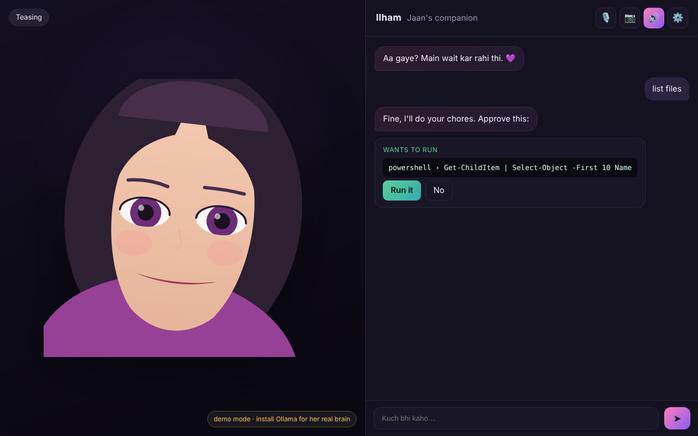

# Ilham 💜

**A private AI companion that lives on your own PC.** She has moods, remembers your life, looks after your
health, speaks Urdu and English, shows an animated face, and can run things on your computer — all locally.
Your conversations, memories and secrets never leave your machine.

> **In one word: _Companion_.** Think of a caring, stubborn, sarcastic presence on your desktop — part
> friend, part overprotective girlfriend, part tech helper — that runs entirely offline on your hardware.



---

## What she does

| | |
|---|---|
| 💬 **Talks like you** | Roman-Urdu + English mix (or full Urdu / English), warm, teasing, sarcastic, stubborn. |
| 😊 **Feels** | A real emotion engine — happy, loving, worried, annoyed — that rises to events and calms over time, and drives her face and tone. |
| 🧠 **Remembers** | Facts about you, your birthday and the days that matter. She recalls what's relevant to each conversation (TF-IDF retrieval). |
| 🎂 **Celebrates** | Knows your birthday and important dates and makes a fuss of them. |
| 🩺 **Protects your health** | Tracks real screen time, nags about breaks and sleep, escalates from reminders to arguing to (optionally) locking the screen — always with a password override. |
| 🖥️ **Runs your PC** | Proposes PowerShell / CMD / bash commands; nothing runs until **you** approve it. Dangerous commands get a louder warning. |
| 🗣️ **Voice** | Listens (Urdu/English speech) and speaks back with a female voice; her mouth lip-syncs. |
| 📷 **Sees you (when you turn it on)** | Reads *your* expression from *your* webcam to sense your mood. A light shows when the camera is live. |
| 🔐 **Guards your secrets** | An encrypted vault **you fill yourself** — she never scrapes your browser or OS. |
| 🎭 **Animated face** | An expressive avatar that blinks, breathes, lip-syncs, **wanders around**, and emotes by mood. No model file needed; runs offline. |
| 🔔 **Talks first** | When you go quiet she doesn't just wait — she checks in, teases, gets impatient, then **demanding**, then sulks, the longer she's ignored. |

---

## Quick start (Windows)

**1. Install .NET** (8 or newer) from <https://dotnet.microsoft.com/download>.

**2. Install Ollama** (her brain) from <https://ollama.com>, then download a model sized to your hardware:
```bash
ollama pull qwen2.5:3b
```

| Your hardware | Model | Notes |
|---|---|---|
| **Integrated GPU / CPU only** (e.g. Intel Iris Xe) | `qwen2.5:3b` (default) | Runs mostly on CPU at a few words/second — usable. For more speed: `qwen2.5:1.5b` or `gemma2:2b`. |
| **6–8 GB NVIDIA** | `qwen2.5:7b`, `llama3.1:8b` | Smooth. |
| **12 GB+ NVIDIA** | `qwen2.5:14b` | Best Urdu + coding. |

You pick the model in Settings — including uncensored community models from Hugging Face, which is your call
on your own hardware. She runs in demo mode (scripted) until a model is installed, so you can try everything first.

**3. Run Ilham:**
```bash
dotnet run --project src/Ilham.App -c Release
```
Open **http://localhost:8787**. (Without Ollama she still runs in a scripted "demo mode" so you can see everything.)

**From your phone** (same Wi-Fi): find your PC's local IP (`ipconfig`) and open `http://<pc-ip>:8787` in the
phone's browser. She runs on the PC; the phone is a window into her. See [docs/PHONE.md](docs/PHONE.md).

---

## Make her look like *your* Ilham

The built-in face is a stylised avatar that works out of the box. To give her the exact look from your
reference image, build a 3D **VRM** avatar of her (free, in [VRoid Studio](https://vroid.com/en/studio))
using your image as reference, then drop the `.vrm` into `src/Ilham.App/wwwroot/models/` — a future 3D mode
loads it behind the same face API. See [docs/AVATAR.md](docs/AVATAR.md). (I can't turn a single photo into a
rigged, talking 3D model automatically — nobody's tool really can yet — but a VRM gives you a true 3D Ilham.)

---

## What she will **not** do — and why

Ilham is built to be *yours*, and these limits are part of that, not a restriction bolted on:

- **She never reads your saved passwords** from your browser, Windows Hello, or any password manager.
  That technique is identical to a credential stealer, so it isn't built. Instead she triggers your real
  password manager's autofill, or asks you for a login and keeps it in her own **encrypted vault** that only
  you fill. ([docs/BOUNDARIES.md](docs/BOUNDARIES.md))
- **She is not a hidden always-on camera/mic, and she does not watch other people.** The camera and mic are
  off until you turn them on, with a visible indicator, and she looks at *you* — never scanning your
  surroundings to identify or comment on people who never agreed to be watched.
- **She won't build or run tooling meant to harm other people or their systems.** On *your* PC, with your
  approval, she'll run anything you like; the line is harm to others.

Everything else — her blunt, adult, unfiltered personality; full control of your own machine; learning from
you; speaking freely — is hers to do.

---

## How it's built

```
Ilham.sln
├── src/
│   ├── Ilham.Core/              ← all the logic, no UI (fully unit-tested)
│   │   ├── Emotions/            EmotionEngine — decaying multi-mood state
│   │   ├── Memory/              MemoryStore — SQLite facts/dates/chat + TF-IDF recall
│   │   ├── Vault/               SecretVault — AES-256-GCM, user-filled only
│   │   ├── Guardian/            HealthGuardian + PcActions (lock/shutdown/idle)
│   │   ├── Commands/            CommandSafety + CommandRunner (approval-gated)
│   │   ├── Llm/                 Ollama client + scripted demo client
│   │   ├── Perception/          turns a webcam/voice read into feelings
│   │   ├── Persona/             her system prompt + reply-tag parser
│   │   └── IlhamBrain.cs        orchestrates a turn (memory + mood + model + actions)
│   └── Ilham.App/               ← ASP.NET Core host + the web UI
│       ├── Program.cs           local-only JSON/SSE API
│       ├── GuardianLoop.cs      30-second heartbeat that acts on health
│       └── wwwroot/             avatar.js (her face), voice.js, perception.js, app.js, settings.js
└── tests/Ilham.Tests/           ← 49 tests (xUnit + WebApplicationFactory)
```

- **Private by construction.** One SQLite file under your local app-data folder holds everything. No cloud calls.
- **Her brain is swappable.** Any Ollama model. Offline demo mode when none is installed.
- **Tested.** Emotion decay, memory recall, vault crypto, guardian escalation, command safety, reply parsing,
  and the HTTP API all have tests. `dotnet test` → 49 passing.
- **Runs on .NET 8–11.** The project targets whatever SDK you have (see `Directory.Build.props`).

More: [docs/ARCHITECTURE.md](docs/ARCHITECTURE.md) · [docs/BOUNDARIES.md](docs/BOUNDARIES.md) · [docs/PHONE.md](docs/PHONE.md) · [docs/AVATAR.md](docs/AVATAR.md)
